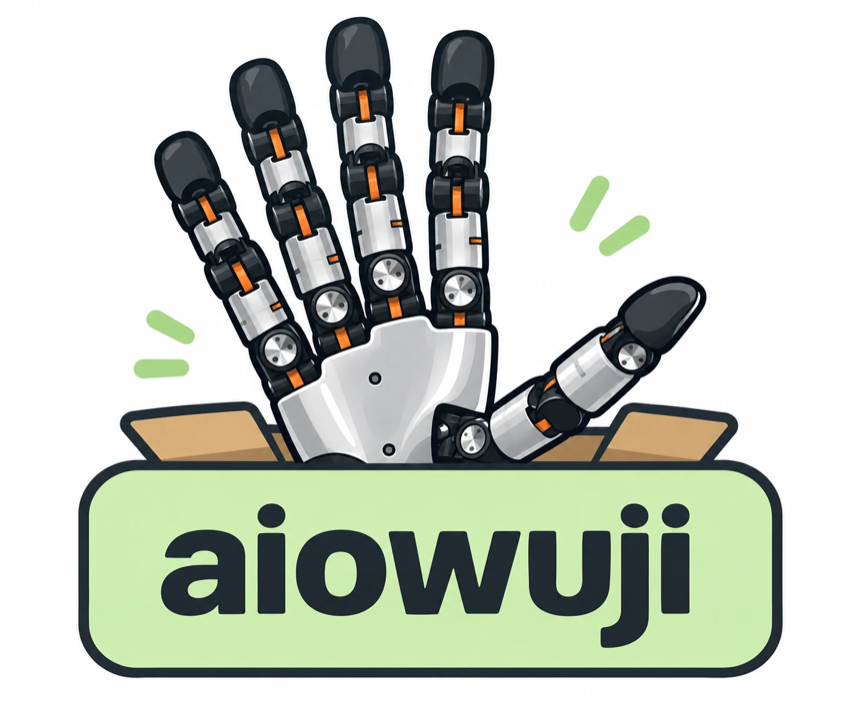

# aiowuji

<div align="center">
  
</div>
<p align="center">
  <a href="https://pypi.org/project/aiowuji/">
    
  </a>
  <a href="https://opensource.org/licenses/MIT">
    
  </a>
</p>

**aiowuji** is an experimental asyncio-based Python library for joint control
of the **Wuji Hand 2** on Linux and Apple Silicon macOS. It streams joint
targets to the hand's firmware PD controller from a 1 kHz background loop,
uses **`Ruckig`** for smooth joint-space moves, and keeps the telemetry and
safety checks in Python.

The API follows [aiofranka](https://github.com/younghyopark/aiofranka) and
[aioflexiv](https://github.com/Improbable-AI/aioflexiv).

This is a hardware-control experiment. Keep the hand clear of people, cables,
and the bench, and be ready to cut power before running any command or script.

## Installation

```bash
pip install aiowuji
```

Or install this repository for development:

```bash
git clone https://github.com/younghyopark/aiowuji.git
cd aiowuji
pip install -e .
```

The install pulls `numpy`, `ruckig`, and the Wuji SDK for your platform. Both
SDK distributions provide `import wuji_sdk`:

| Platform | SDK distribution |
| --- | --- |
| Linux x86_64 / aarch64 (glibc 2.34+) | [`wuji-sdk`](https://pypi.org/project/wuji-sdk/) 2026.9.22+, the official Python SDK |
| macOS on Apple Silicon | [`wuji-macos`](https://github.com/younghyopark/wuji-macos-sdk), a port of the Wuji SDK 2026.9.22 native code |

Hand firmware 2.7.0 and later only accepts SDK connections on port 50001, which
needs SDK 2026.9.22 or later.

`wuji-macos` is not on PyPI yet. Build it from
[younghyopark/wuji-macos-sdk](https://github.com/younghyopark/wuji-macos-sdk)
(`python scripts/build_macos.py`), then point pip at the wheel:

```bash
pip install --find-links /path/to/wuji-macos-sdk/dist -e .
```

On macOS aiowuji keeps SDK users and calibrations in `~/.wuji`, as the official
SDK does on Linux. Set `WUJI_MACOS_STATE_DIR` to use another directory.

## Quick Start

- **Single script**: no separate server process
- **Firmware PD**: the hand runs the joint PD loop; Python streams its targets
- **Async discipline**: `start()` launches a 1 kHz thread; keep `await controller.stop()` in a `finally` block

Pass the serial number on first use. After a successful connection, aiowuji
stores it in `~/.config/aiowuji/config.json`, and `WujiController()` reuses it.
With no saved serial, the only discovered Wuji Hand 2 is used.

```python
import asyncio
import numpy as np
from aiowuji import WujiController

async def main():
    controller = WujiController("<HAND_SN>")

    await controller.start()
    try:
        controller.switch("impedance")
        controller.kp = np.ones(controller.dof) * 3.0
        controller.kd = np.ones(controller.dof) * 0.05
        controller.set_freq(50)

        q0 = controller.initial_qpos.copy()
        for cnt in range(250):
            target = q0.copy()
            target[16] += 0.05 * np.sin(cnt / 50.0)
            await controller.set("q_desired", target)
    finally:
        await controller.stop()

if __name__ == "__main__":
    asyncio.run(main())
```

## CLI Reference

```text
aiowuji scan
aiowuji status [HAND_SN]
```

`aiowuji scan` lists discovered Wuji devices. `aiowuji status` connects
read-only and prints firmware, handedness, and every joint's position, state,
error code, gains, and effort limit.

## Core Concepts

### Control Loop

`WujiController.start()` connects, refuses to continue unless all 20 joints are
online, Ready, fault-free, and inside their documented range, sets the gains and
effort limit, then enables the hand while a background thread streams the
measured pose. The thread runs at `rate_hz` (1 kHz by default): it reads the
newest `joint_states`, checks `joint_diagnostics`, and sends one 20-joint
command. `stop()` disables the hand, confirms it from fresh telemetry, falls back
to an emergency stop, and only then restores the gains the hand had before.

While the loop runs, aiowuji lowers Python's thread switch interval to 0.5 ms
(`sys.setswitchinterval`) so the loop thread is not stalled for 5 ms by other
Python threads, and restores it on `stop()`. The loop thread also asks for
better scheduling. On macOS it takes QoS class `USER_INTERACTIVE`, as aiofranka
does, which keeps it on performance cores, and then the Mach real-time
(time-constraint) policy that Core Audio threads use: it declares its period, a
CPU budget of half the period and a deadline of 90% of it, runs ahead of every
QoS class, and is demoted to normal priority if it overruns the budget. No root
is needed. On Linux it asks for `SCHED_FIFO` priority 80 when permitted (root or
`CAP_SYS_NICE`). `controller.thread_priority` reports what it got
(`mach_realtime`, `qos_user_interactive`, `sched_fifo_80` or `default`); pass
`realtime_priority=False` to skip this.

### Recording

`controller.start_recording()` records every loop tick until
`controller.stop_recording()`, which returns NumPy arrays: when each tick ran
and was due, time spent sending, the command sent, and the newest telemetry.
`scripts/log_move.py` runs the `00_move.py` sequence with recording on and
saves the result under `logs/`. `scripts/sysid_ref_collect.py` collects data
for simulator system identification: for each finger and each `kp:kd` setting,
the finger's four joints track one continuous 21.6 s trajectory, all at once
(steps, slow sines at the maximum amplitude, and a multisine whose harmonics are
interleaved across the joints so each joint's response can be separated, with
the speed capped at 2 rad/s). The trajectories are planned against the bundled
Wuji Hand 2 model so the finger keeps 5 mm (`--margin`) from the other fingers
and the palm: the other fingers spread away from it (`--spread`), each joint's
amplitude is capped to its collision-free range, and segments that would still
come too close are scaled down. `--plan` prints the result. Before every trial
the hand moves home and then to the trial's pose with stiff gains. Every trial's
per-tick recording is saved under `logs/sysid-<UTC time>/` with a
`manifest.json`; the default run (5 fingers, 3 settings) takes about 6 minutes
and needs MuJoCo and tqdm (`pip install "aiowuji[sysid]"`). `--plan` prints the trials and the estimated time, and
`--resume [DIR]` continues a stopped run (the newest by default) after checking
that its recorded trials match the plan for the options given.

### Hand model

`src/aiowuji/models/wuji_hand2` bundles Wuji Technology's official Wuji Hand 2
(Beta 2) MuJoCo models, left and right, unmodified from
[wuji-description](https://github.com/wuji-technology/wuji-description) (MIT).
Their joints are aiowuji's joints in the same order and with the same limits.
`aiowuji.model.HandModel` poses a model with the 20 joint angles and measures
how close a finger comes to the rest of the hand, which the sysid collector uses
to plan collision-free trajectories. It needs `pip install "aiowuji[sim]"`.

### Units

The Wuji SDK expresses effort as motor current in amperes (its torque constant
is 1). `kp` is in A/rad, `kd` in A·s/rad, and `effort_limit`, `effort_ff`, and
`torque` in A. `effort_limit` defaults to 0.5 A and is capped at 1.5 A, the
value used by the vendor examples.

### Safety Limits

The loop disables the hand when `joint_states` stop arriving for `stale_ms`
(20 ms), a joint drops out, or a joint reports a fault or leaves Enabled.
A parameter write (gains, enable) holds the hand's telemetry back for up to
about 20 ms: frames arrive late, none are lost. While aiowuji's own write is in
flight and for 100 ms after it, telemetry may be up to 150 ms old.
Passing `max_tracking_error` (rad) also stops it when an impedance-mode joint
falls that far behind its target; it is off by default, since fast moves lag
and pushing a held finger is often the point. `effort_limit` bounds the push.
Firmware warnings such as `Stall` are collected in `controller.warnings`
instead. `q_desired` and
`move()` targets must be inside the documented joint ranges, and `effort_ff` and
`torque` must be within `effort_limit`.

Reported joint velocity is not used for safety: on Wuji Hand 2 it can exceed
0.5 rad/s while the joint output is stationary. If the process dies without
`stop()`, the firmware keeps holding the last target with the configured gains.

### Rate Limiting

Use `set_freq()` to pace command updates:

```python
controller.set_freq(50)

for target in trajectory:
    await controller.set("q_desired", target)
```

The loop keeps streaming the latest target at `rate_hz` between updates.

### State

`controller.state` holds the newest telemetry as NumPy arrays in joint order
(`thumb_S1` … `pinky_S4`, see `aiowuji.JOINT_NAMES`):

```python
state = controller.state
state["qpos"], state["qvel"], state["effort"]   # rad, rad/s, A
```

### Transports

On macOS the loop reads and writes through the port's native receivers and
publisher directly (`controller.transport.name == "native"`), which avoids
building Python objects for every frame. Everywhere else it uses the public
`wuji_sdk` API (`"sdk"`). Pass `transport="sdk"` to force the portable path.

## Controllers

### 1. Joint Impedance

The hand firmware's PD (MIT mode) tracks the target:
`effort = kp * (q_desired - q) + kd * (qd_desired - qd) + effort_ff`.

```python
controller.switch("impedance")
controller.kp = np.ones(controller.dof) * 3.0
controller.kd = np.ones(controller.dof) * 0.05
await controller.set("q_desired", target_qpos)
```

Setting `kp` or `kd` sends the gains to the hand immediately, one write each;
`controller.set_gains(kp=..., kd=...)` sends both in a single write.

**Use case**: compliant joint-space holding and trajectory tracking.

**Friction compensation.** Wuji Hand 2 joints have enough static friction that
slow moves stick and slip: the joint holds still while the PD winds up, then
jumps a degree or two. `friction` adds a push in the direction the target moves,
`friction * tanh(qd_desired / friction_velocity)`, so the PD only supplies the
difference. It is zero while the target is still, so holding is unchanged:

```python
controller.friction = 0.08   # A, scalar or one value per joint
```

On one hand, the S1 joints needed about 0.1–0.2 A to break free (pinky about
0.03 A); stay a bit below that.

**Firmware feed-forward.** Hand firmware 2.10.0 and later can add its own
feed-forward terms inside the joint loop: a constant term, a velocity-indexed
table, and a position-indexed table (compensation for position-dependent
cogging). Wuji documents it as on by default. The setting lives in RAM and the
firmware only accepts writes, so it cannot be read back. `feed_forward=True`
turns all three terms on before the motors are enabled, `False` turns them off,
and `None` (the default) leaves the hand as it is:

```python
controller = WujiController(feed_forward=True)
```

`scripts/log_move.py --feed-forward on|off` does the same, which makes it easy to
compare runs. It only helps if the hand was calibrated: on the hand this was developed
with, every joint reported `od/ucfg/ff_calibrated_bits = 0`, and turning
feed-forward on or off made no measurable difference.

**Why slow moves step.** Measured on one hand, a joint breaks free at about
0.075 A of push, slides with 0.02-0.035 A of friction at speed, and seizes
again while still being pushed with 0.04-0.05 A as it slows: friction rises
at low speed (the Stribeck effect). Below some speed that is stick-slip no
constant feedforward removes; `friction` and higher `kp` only shrink it.
`scripts/log_move.py --max-velocity` (with `--max-acceleration` and
`--max-jerk` for fast moves) measures where motion becomes smooth.

### 2. Direct Torque

Firmware gains are set to zero and `torque` is sent as the motor current:

```python
controller.switch("torque")
controller.set_freq(500)
await controller.set("torque", np.zeros(controller.dof))
```

**Use case**: running your own control law in Python.

### 3. Ruckig Moves

Point-to-point joint motions are generated with Ruckig. The loop samples the
trajectory's position and velocity at `rate_hz` as impedance targets:

```python
await controller.move()            # all joints to zero, the vendor home pose
await controller.move(target_qpos, max_velocity=0.5)
```

## Examples

```bash
python examples/00_move.py <HAND_SN>
python examples/01_joint_impedance.py <HAND_SN>
python examples/02_host_pd.py <HAND_SN>
python examples/03_zero_torque.py <HAND_SN>
```

Every example enables the motors. `00_move.py` goes finger by finger, moving
one joint of each (`--slot`, S1 by default) by `--delta` radians and back
`--cycles` times (1.0 rad at up to 2 rad/s, 0.8 s each way, about 24 s in total). `01_joint_impedance.py` holds the initial pose softly
(kp 1.0 A/rad) with no tracking-error stop, so the fingers can be pushed and
spring back. `02_host_pd.py` does the same with the PD law run in Python
through torque mode.
`03_zero_torque.py` enables with zero current so the fingers can be moved by
hand.

To test the loop without enabling anything, pass `dry_run=True`: aiowuji
connects and runs the loop but does not change gains, enable, or send commands.

## License

MIT. See [LICENSE](LICENSE).

## Acknowledgments

- Built on the [Wuji SDK](https://github.com/wuji-technology/wuji-sdk)
- Trajectory generation with [Ruckig](https://github.com/pantor/ruckig)
